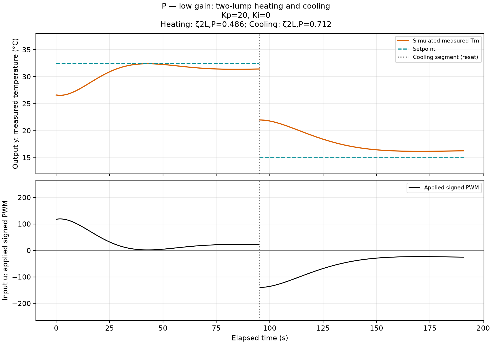
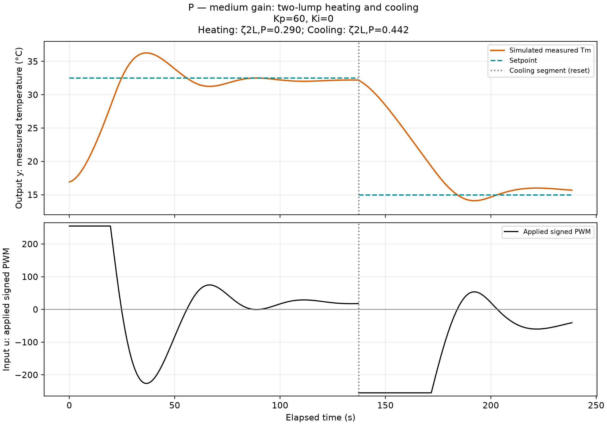
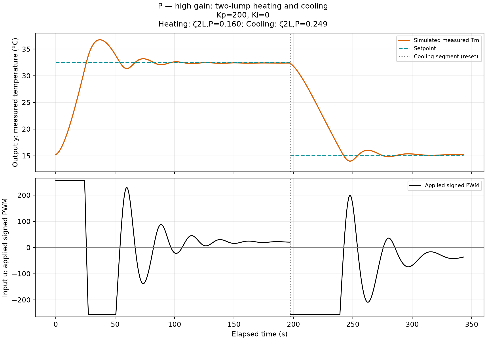
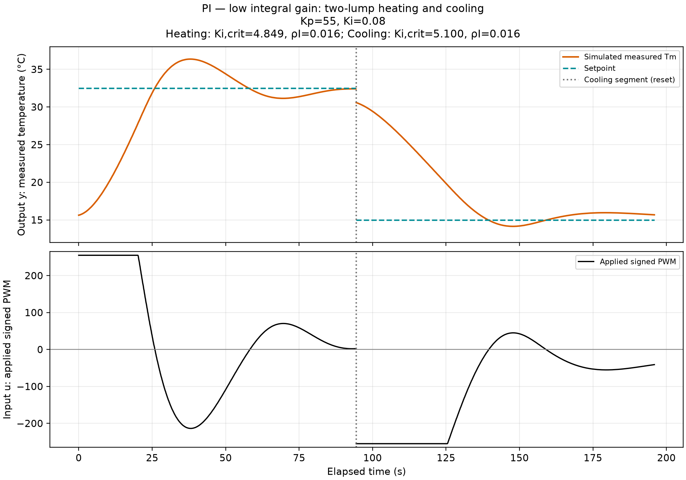
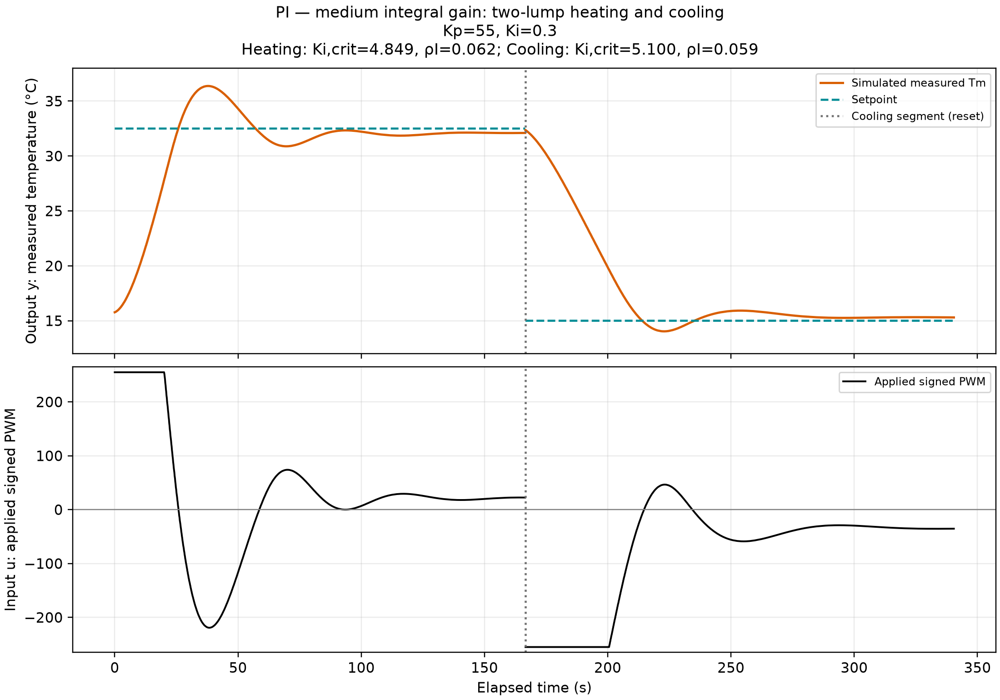
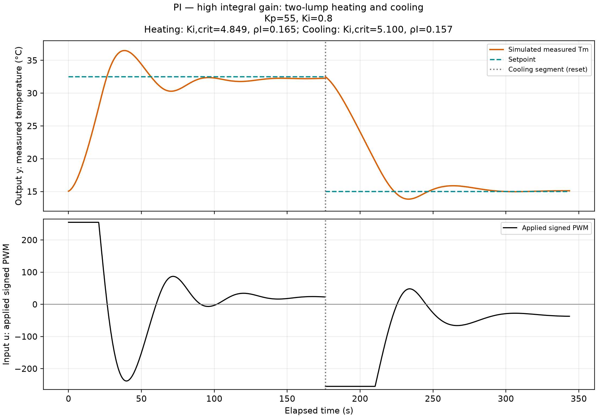
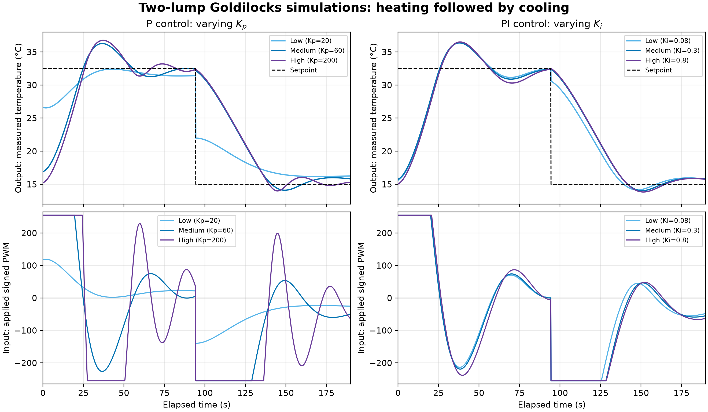

All six simulations use Tamb = 22 °C, χc = 0.20 and χh = 0.4872 °C/PWM, τ = 97 s, VTEC = 12 V (experimental voltage unconfirmed), RM = 1.50 Ω, G = 2 W/K, CT/C = 0.35, PWM limits ±255, Euler step 0.05 s, and conditional-integration anti-windup; the inferred C = 127.1506 J/K and H = 1.3108 W/K are fixed throughout.

Curves are regenerated with the supplied GUI model, not extracted from screenshots. Each direction starts with both lumps at the recorded first measured temperature and zero integral; directions are reset separately and displayed consecutively. The hidden TEC-side initial temperature is assumed. Experimental initial-condition differences and segment discontinuities are retained. Stability values below are local, unsaturated, direction-specific predictions.

Kp = 20, Ki = 0; Heating: ζ2L,P=0.486; Cooling: ζ2L,P=0.712.

Kp = 60, Ki = 0; Heating: ζ2L,P=0.290; Cooling: ζ2L,P=0.442.

Kp = 200, Ki = 0; Heating: ζ2L,P=0.160; Cooling: ζ2L,P=0.249.

Kp = 55, Ki = 0.08; Heating: Ki,crit=4.849, ρI=0.016; Cooling: Ki,crit=5.100, ρI=0.016.

Kp = 55, Ki = 0.3; Heating: Ki,crit=4.849, ρI=0.062; Cooling: Ki,crit=5.100, ρI=0.059.

Kp = 55, Ki = 0.8; Heating: Ki,crit=4.849, ρI=0.165; Cooling: Ki,crit=5.100, ρI=0.157.

Overlay directions are truncated to the shortest experimental heating and cooling durations so all transitions and endpoints align, as in Part I. All simulation temperature axes use 12–38 °C to show the full overshoot and undershoot; experimental figure temperature axes will need the same range in the final comparison assembly.

Regenerate: `python3 "Part II/Step 5/generate_plots.py"`.

### Growth followed by saturation

A separate reproduction of the Step 4 demonstration uses Tamb = T0 = 29 °C, Tset = 30 °C, C = 100 J/K, CT/C = 0.50, G = 2 W/K, H = 1.14 W/K, Pu,c = 0.26 W/PWM, r = 2, Kp = 10, Ki = 3, and anti-windup on. Ki,crit = 1.253, so ρI = 2.394. Before approximately 357.5 s, oscillations grow while the command is unsaturated: evidence of linear instability. Applied PWM first reaches a limit at approximately 357.5 s. Later clipping at ±255 limits the oscillation amplitude; bounded oscillation reflects the nonlinear actuator limit, not restored linear stability. This timing comes from the supplied Euler model at Δt = 0.05 s, not a measurement. No extra plot is included.

### PI predictions and resets

For Ki = 0.08, 0.30, and 0.80 at Kp = 55, heating ρI increases from 0.016 to 0.062 to 0.165; cooling ρI increases from 0.016 to 0.059 to 0.157. All predict decaying oscillations, not marginal or unstable behavior. Larger ρI moves toward the stability boundary, but all three remain far below 1. Each segment resets the integral to zero with anti-windup enabled; captions give Kp, Ki, Ki,crit, and ρI.

### 1. Which simulations best match the experiments?

No case reproduces all three response measures. Low-P heating matches rise time closely (17.53 s simulated versus 17.54 s experimental), but overpredicts overshoot (21.02% versus 0.12%). Low-P cooling gives the closest settling time (58.21 s versus 60.54 s). Low-PI has the smallest overall rise/settling discrepancies among the PI cases, but remains a poor quantitative match: heating rise time is 17.90 s versus 5.71 s and settling is 83.16 s versus 19.42 s. Metrics use the Part I 10–90% rise and ±2% settling definitions around the finite-record final temperature.

### 2. How do the P gains organize the responses?

The critical-damping gain Kp,crit is 3.15 PWM/°C for heating and 7.67 PWM/°C for cooling. All three experimental gains (20, 60, 200) exceed these values. Increasing Kp reduces heating ζ from 0.486 to 0.290 to 0.160 and cooling ζ from 0.712 to 0.442 to 0.249: all are locally stable underdamped P cases. Kp,crit marks critical damping, not a P instability boundary. PWM saturation means faster local dynamics do not guarantee monotonically shorter measured rise times.

### 3. How does increasing ρI organize the PI responses?

All three PI simulations are stable underdamped, with decaying oscillations. Higher Ki increases ρI and strengthens integral action, but saturation makes the initial responses similar and settling need not vary monotonically. High-PI heating takes 125.32 s to settle in simulation versus 83.16 s for low PI. None of these retained gains reaches ρI = 1; marginal and unstable behavior belong to the preliminary sweep.

### 4. Agreement, disagreement, and gain choice

Agreement: both experiment and simulation show overshoot at larger gains and finite heating/cooling asymmetry. Disagreement: simulated high-P heating settles in about 80.33 s, while experimental high-P heating has sustained oscillation and no measured settling time. The positive-parameter, fixed-direction linear two-lump P model cannot produce sustained or growing oscillations; persistent experimental ringing contradicts that model under its assumptions and points to omitted delay, actuator dynamics, or additional thermal states. The switched, saturated simulation shown here still produces decaying oscillations.

Experimental low/medium-P responses are approximately stable non-oscillatory or have a single overshoot; high-P heating is sustained-oscillatory over the recorded interval, while high-P cooling settles. Sustained oscillation in a finite, saturated record does not establish ideal marginal stability. The PI records appear stable with decaying transients, although low-PI cooling starts at only 30.58 °C and its finite duration limits conclusions about zero final error. No recorded case establishes unbounded instability. All six simulations have decaying underdamped transients; none demonstrates marginal stability or growth.

A provisional experimental compromise is P Kp = 60: fast heating without the sustained oscillation at 200. For PI, Kp = 55 and Ki = 0.30 is a reasonable middle choice that reduces the residual error of Ki = 0.08 without choosing the most aggressive integral action. Ki = 0.80 does not shorten the measured heating settling time relative to 0.30 (29.34 s versus 27.99 s). This is a practical candidate, not a model-validated optimum; unmatched initial conditions, substantial simulation error, and the lack of a stated acceptable-error tolerance prevent a definitive ranking.
